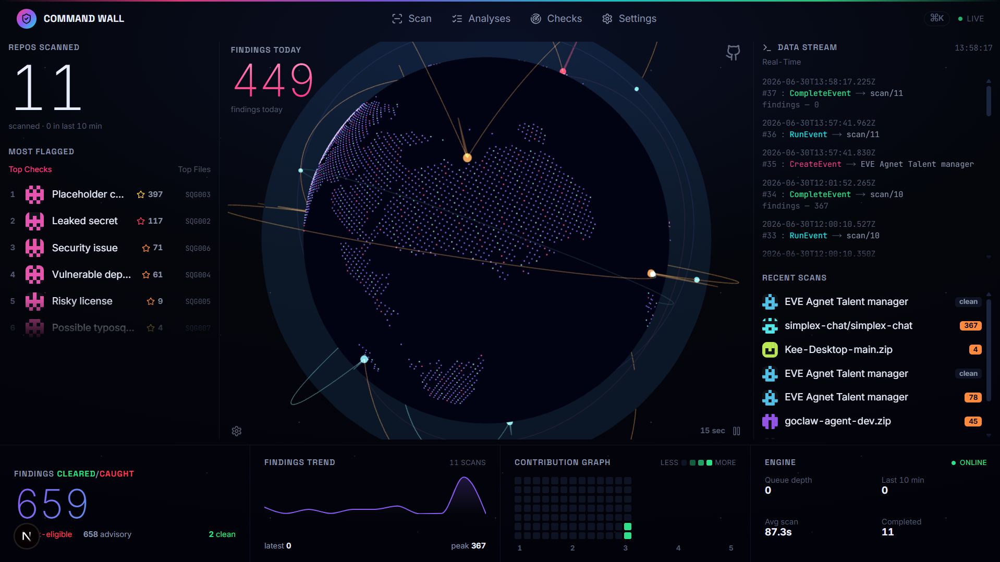

<h1 align="center">AI Slop Quarantine Guard</h1>

<p align="center">
  <strong>A pre-release quality &amp; security gate for the age of AI-generated code.</strong><br/>
  It runs every machine-checkable test for AI "slop" — hallucinated packages, leaked secrets,
  known-vulnerable dependencies, risky licenses, dangerous code, placeholder stubs, and typosquats —
  then explains the results in plain English. It blocks <em>only</em> on facts it can prove, and
  it never lies to you about one.
</p>

---

## The Command Wall



A real-time mission-control view of every scan: live **findings-by-check** ranking
(SQG001–SQG007), a streaming event feed, recent scans with clean/flagged counts, a
**cleared-vs-caught** tally that separates *block-eligible* findings from *advisory* ones, a
findings trend, and engine health (queue depth, average scan time). The Guard's honesty model,
visible at a glance.

---

## The problem

AI coding tools ship fast — and they ship *slop*: packages that don't exist, secrets pasted into
source, half-finished stubs, vulnerable or wrongly-licensed dependencies, and names that look right
but aren't (`reqeusts`, `python-dotnev`). A human reviewer can't catch all of it, and most scanners
either miss the AI-specific failures or cry wolf so often you stop listening.

## The approach — two layers, never mixed

| Layer | What it is | Behaviour |
|---|---|---|
| **The Guard** | A deterministic engine of proven checks that don't guess. | The defensible core. Marks a finding **CERTAIN / block-eligible** only when it is *reproducible* (e.g. a clean 404 from a reachable registry, a checksum-shaped key). A registry or tool outage **downgrades to advisory — it never produces a false block.** |
| **The Crew** | An advisory AI explainer (optional). | Translates findings to plain English and suggests fixes. **Advisory only** — never blocks, never overrides a Guard conclusion, never asserts "an AI wrote this." |

**The promise:** *we run every known check the best teams run, catch what those checks can catch, and we never lie to you about a fact.* Honesty outranks feature velocity.

## What it catches

| Rule | Catches | How |
|---|---|---|
| **SQG001** | Hallucinated / non-existent packages | Live 404 from a *reachable* registry (PyPI, npm, crates) — outage → advisory, never CERTAIN |
| **SQG002** | Leaked secrets | Distinctive token shapes (AWS, GitHub, Stripe, Slack, Google, PEM keys); generic credential assignments are advisory; values are always redacted |
| **SQG003** | Placeholder / incomplete code | `NotImplementedError` stubs, ellipsis bodies, "your code here" — string literals & comments are lexically excluded to cut noise |
| **SQG004** | Known-vulnerable dependencies | Exactly-pinned versions checked against the OSV database (batched) |
| **SQG005** | Risky licenses | Copyleft / restrictive license metadata from the registry |
| **SQG006** | Dangerous code (lightweight SAST) | `eval`/`exec`, `os.system`, `shell=True`, unsafe `pickle`/`yaml.load`, `innerHTML`/`dangerouslySetInnerHTML` — sinks inside strings/comments are skipped |
| **SQG007** | Typosquatting | Edit-distance match against popular package names — **always advisory, never blocks** |

## How it works

```
   PR webhook  ┐
   Public URL  ├──►  ingest (honors .gitignore, skips build output/vendored deps)
   Upload .zip ├──►  in-memory {path: content}  ──►  synthetic diff
   Local folder┘                                          │
                                                          ▼
                            ┌──────────── The Guard ────────────┐
                            │  SQG001…SQG007 analyzers (async,   │
                            │  per-analyzer time budget, OSV     │
                            │  batched, registry-outage = safe)  │
                            └───────────────────┬────────────────┘
                                                ▼
                       findings (CERTAIN = block-eligible · HIGH/MEDIUM = advisory)
                                                ▼
            GitHub Check-Run (label-only today)   +   Command-Wall dashboard
                                                ▼
                          The Crew — optional plain-English explainer
```

- **Four ways in:** a GitHub pull-request webhook, a public repo URL, an uploaded `.zip`, or a local folder.
- **Safe by construction:** ingestion honors `.gitignore`/`.dockerignore` and skips build output, caches, and vendored dependencies, so the scanner judges *shipped source* — not artifacts. Cloned/zipped code is read as text and **never executed**.
- **Honest gating:** today the GitHub check is **label-only** (clean → success, findings → "action required") — it never blocks a merge. Real blocking is opt-in and gated behind a measured false-positive rate.

## Tech stack

- **Backend** — Python 3.12 · FastAPI (async) · SQLAlchemy 2.0 · Redis queue + background worker · SQLite by default, PostgreSQL for production. Analyzers are pure-Python/HTTP (no external scanner binaries).
- **Frontend** — Next.js 15 · React 19 · Tailwind · an "Aurora-on-Black" Command-Wall dashboard.
- **Quality bar** — 250+ tests; analyzers are gated at **zero false positives** on a negative-fixture set.

## Quick start

**Prerequisites:** Python 3.12+, Node 20+, and a Redis instance (local, Docker, or a free cloud URL). Docker optional.

### Option A — Docker backend + npm frontend (easiest)
```bash
cd infra && docker compose up          # API :8000, worker, redis, postgres
# in another terminal:
cd web && npm install && npm run dev    # dashboard :3000
```

### Option B — manual
```bash
cp .env.example .env                    # defaults are fine for local (SQLite, no keys needed)
# start a Redis: `docker run -p 6379:6379 redis:7-alpine`  (or set REDIS_URL to a cloud URL)

cd api
python -m venv .venv
# Windows: .venv\Scripts\activate    |    macOS/Linux: source .venv/bin/activate
pip install -e ".[dev]"
# terminal 1 — API:    PYTHONPATH=. python -m uvicorn app.main:app --port 8000
# terminal 2 — worker: PYTHONPATH=. python -m app.worker

cd ../web && cp .env.example .env.local && npm install && npm run dev
```
Open **http://localhost:3000**. The SQLite database is created automatically.

> **Windows shortcut:** double-click `start.bat` — it frees ports, clears the Next.js cache, and launches web + API + worker together (expects Redis set in `.env`).

## Configuration

Backend `.env` (see `.env.example`) — all optional for local use:

| Variable | Purpose | Default |
|---|---|---|
| `REDIS_URL` | Job queue | `redis://localhost:6379` |
| `DATABASE_URL` | Database | `sqlite:///./app.db` |
| `GITHUB_APP_ID` / `GITHUB_APP_PRIVATE_KEY` / `GITHUB_WEBHOOK_SECRET` | PR-webhook mode only | empty |
| `LLM_BASE_URL` / `LLM_MODEL` / `LLM_API_KEY` | The Crew explainer (leave key empty to disable) | NVIDIA NIM endpoint |
| `DISABLED_ANALYZERS` | Kill-switch, e.g. `SQG001,SQG004` | empty |
| `API_KEY` / `RATE_LIMIT_PER_MINUTE` | Scan-API protection | open / 60 |

Frontend `web/.env.local` (see `web/.env.example`): `NEXT_PUBLIC_API_URL`, and optionally `NEXT_PUBLIC_SUPABASE_URL` + `NEXT_PUBLIC_SUPABASE_ANON_KEY` to enable sign-in.

## Tests

```bash
cd api && python -m pytest -q
```

## Status

Deterministic engine (SQG001–SQG007), whole-repo scanner (URL / zip / local folder), and the
Command-Wall dashboard are working. The GitHub check is **label-only** — it surfaces findings but
does not block merges yet. On the roadmap: AST-level placeholder detection, a fuller SAST engine,
SARIF export, and a public Trust-Score leaderboard.

## License

_No license file yet — add one (e.g. MIT or Apache-2.0) before sharing publicly; without it, others have no legal right to use the code._
