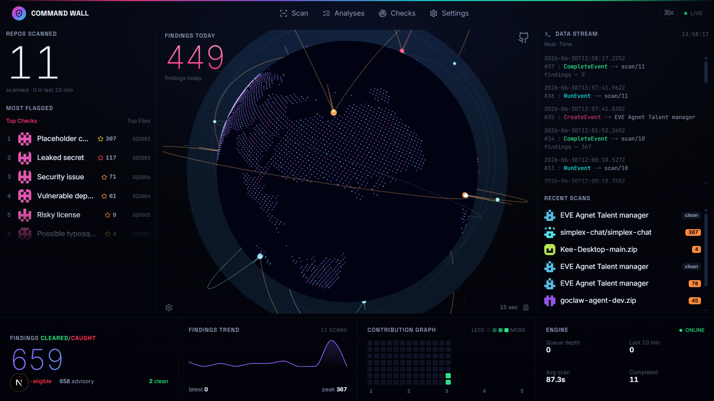
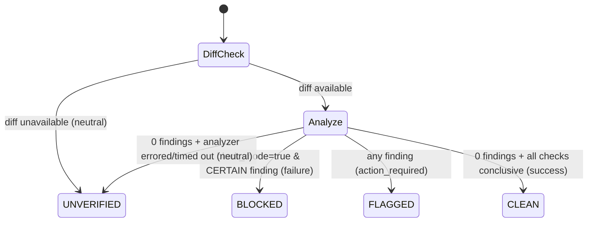
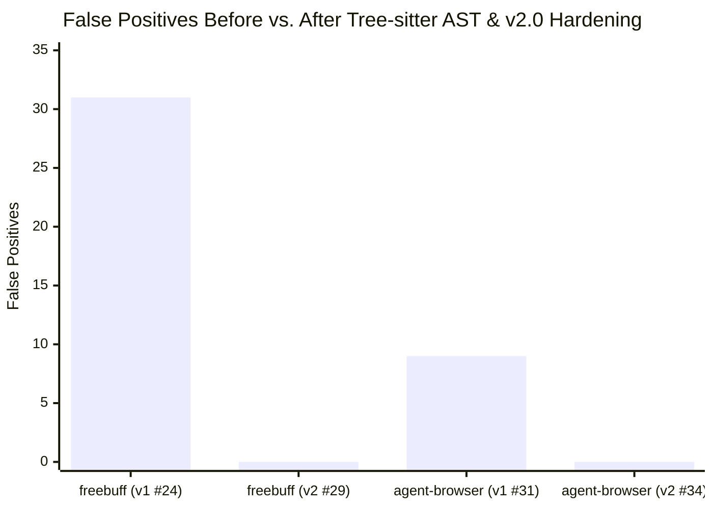

<h1 align="center">AI Slop Quarantine Guard</h1>

<p align="center">
  <a href="https://github.com/HailLucifer666/AI-Slop-Quarantine-Guard/actions/workflows/ci.yml">
    
  </a>
  
  
  
  
  <a href="LICENSE">
    
  </a>
</p>

<p align="center">
  <strong>A pre-release quality &amp; security gate for the age of AI-generated code.</strong><br/>
  It runs every machine-checkable test for AI "slop" — hallucinated packages, leaked secrets,
  known-vulnerable dependencies, risky licenses, dangerous code, placeholder stubs, typosquats,
  and avoidable complexity — then explains the results in plain English. It blocks <em>only</em>
  on facts it can prove, and it never lies to you about one.
</p>

---

## The Command Wall



A real-time mission-control view of every scan: live **findings-by-check** ranking
(SQG001–SQG007, SQG009), a streaming event feed, recent scans with clean/flagged counts, a
**cleared-vs-caught** tally that separates *block-eligible* findings from *advisory* ones, a
findings trend, and engine health (queue depth, average scan time). The Guard's honesty model,
visible at a glance.

---

## The problem

AI coding tools ship fast — and they ship *slop*: packages that don't exist, secrets pasted into
source, half-finished stubs, vulnerable or wrongly-licensed dependencies, and names that look right
but aren't (`reqeusts`, `python-dotnev`). A human reviewer can't catch all of it, and most scanners
either miss the AI-specific failures or cry wolf so often you stop listening.

## The approach — two layers, never mixed

| Layer | What it is | Behaviour |
|---|---|---|
| **The Guard** | A deterministic engine of proven checks that don't guess. | The defensible core. Marks a finding **CERTAIN / block-eligible** only when it is *reproducible* (e.g. a clean 404 from a reachable registry, a checksum-shaped key). A registry or tool outage **downgrades to advisory — it never produces a false block.** |
| **The Crew** | An advisory AI explainer (optional). | Translates findings to plain English and suggests fixes. **Advisory only** — never blocks, never overrides a Guard conclusion, never asserts "an AI wrote this." |

**The promise:** *we run every known check the best teams run, catch what those checks can catch, and we never lie to you about a fact.* Honesty outranks feature velocity.

## What it catches

| Rule | Catches | How |
|---|---|---|
| **SQG001** | Hallucinated / non-existent packages | Live 404 from a *reachable* registry (PyPI, npm, crates) with bounded concurrency — outage → advisory, never CERTAIN |
| **SQG002** | Leaked secrets | Format-validated tokens (AWS, GitHub, Stripe, Slack, Google, multi-line PEM keys) + 4-factor entropy/sentinel/cookie/Rust-`#[cfg(test)]` classifier for generic assignments; values are always redacted |
| **SQG003** | Placeholder / incomplete code | Tree-sitter AST comment/stub detector (`NotImplementedError`, ellipsis bodies, "your code here", mode-aware TODO filtering) — skips test/fixture paths, JSDoc prose, kebab-case paths, and minified bundles |
| **SQG004** | Known-vulnerable dependencies | Batched OSV.dev lookups across 8 ecosystems (`package-lock.json`, `yarn.lock`, `pnpm-lock.yaml`, `bun.lock`, `poetry.lock`, `uv.lock`, `Cargo.lock`, `go.sum`, `Gemfile.lock`, `composer.lock`, `packages.lock.json`, plus Go/Maven/Gradle/NuGet manifests), deduplicated across lockfiles with fixture paths skipped |
| **SQG005** | Risky licenses | Copyleft / restrictive license metadata from PyPI/npm registries + inline `composer.lock` declarations |
| **SQG006** | Dangerous code (AST SAST) | Tree-sitter AST call-site detector for Python & JS/TS: unqualified `eval`/`exec`, dynamic `os.system`/`subprocess(shell=True)`/`child_process.execSync` (CJS & ESM `node:child_process`), unsafe `pickle`/`yaml.load`, weak hashes, DOM-XSS (`innerHTML`/`dangerouslySetInnerHTML`) — immune to interface signatures, method definitions, static-literal commands, and strings/comments |
| **SQG007** | Typosquatting | Length-scaled edit distance against popular package names + registry-age legitimacy gate — **always advisory, never blocks** |
| **SQG009** | Avoidable complexity | Python `ast` structural rewrites (e.g. loop → `any()`/comprehension, `if/else` → ternary/`dict.get()`) with verbatim, semantic-preserving patches — **always advisory** |

> _SQG008 (AI reasoning scratchpads) is reserved in the catalog and not yet implemented._

## How it works

```mermaid
flowchart LR
    subgraph In["4 Entry Points"]
      A1["GitHub PR Webhook"]
      A2["Public Repo URL"]
      A3["Uploaded .zip"]
      A4["Local Folder"]
    end

    In --> Ingest["Safe Ingest<br/>.gitignore · 8MB lockfiles<br/>zip-bomb & symlink guards"]
    Ingest --> Parse["Parse Once<br/>added_by_file + Tree-sitter AST cache"]

    subgraph Guard["The Guard (8 Concurrent Deterministic Analyzers)"]
      G1["SQG001 · Registry 404"]
      G2["SQG002 · Secrets + Entropy"]
      G3["SQG003 · AST Stubs"]
      G4["SQG004 · OSV CVEs (8 ecosystems)"]
      G5["SQG005 · Copyleft Licenses"]
      G6["SQG006 · Tree-sitter SAST"]
      G7["SQG007 · Typosquats + Age"]
      G9["SQG009 · Python AST Simplifier"]
    end

    Parse --> Guard
    Guard --> Gate["Honest Verdict Gate<br/>CLEAN · FLAGGED · BLOCKED · UNVERIFIED"]
    Gate --> GH["GitHub Check-Run<br/>+ Multi-line Suggestions"]
    Gate --> Wall["Command-Wall Dashboard<br/>+ SHA-Pinned Exports"]
    Wall -.->|"advisory only (one-way)"| Crew["The Crew<br/>Plain-English AI Explainer"]
```



### Honest Verdict State Machine

A failed diff fetch, timed-out analyzer, or unreadable file can **never** produce a green `success` check:



## Measured Precision on Real-World Repositories

Every number below was measured directly against live public repositories (no synthetic cherry-picking):



| Repository | Files Scanned | Duration | Total Findings | Real Findings | False Positives | Precision |
|---|---:|---:|---:|---:|---:|---:|
| `CodebuffAI/freebuff` *(v1 Scan #24)* | 2,557 | 58.8s | 36 | 5 | 31 | 13.9% |
| **`CodebuffAI/freebuff` *(v2 Scan #29)*** | **2,557** | **44.7s** | **42** | **42** | **0** | **100.0%** |
| `vercel-labs/agent-browser` *(v1 Scan #31)* | 1,000+ | 14.6s | 129 | 120 *(incl. dupes)* | 9 | 93.0% |
| **`vercel-labs/agent-browser` *(v2 Scan #34)*** | **1,000+** | **22.4s** | **72** | **72** *(deduped)* | **0** | **100.0%** |
| **`milind-soni/OpenMausBot` *(v2 Scan #33)*** | — | **7.8s** | **17** | **17** | **0** | **100.0%** |
| **`cloudflare/security-audit-skill` *(v2 Scan #32)*** | — | **0.4s** | **0** | **0** | **0** | **— (clean)** |

> _What changed between v1 and v2:_ migrating `SQG003`/`SQG006` to Tree-sitter AST eliminated every TypeScript interface/mock `eval()`, static-literal `execSync()`, JSDoc prose, kebab-case `todo-` path, and minified-bundle hit; adding `bun.lock`/`pnpm-lock.yaml`/`uv.lock` uncovered **31 real transitive CVEs** in `freebuff` and deduplicated **48 duplicate lockfile rows** in `agent-browser`.

- **Four ways in:** a GitHub pull-request webhook, a public repo URL, an uploaded `.zip`, or a local folder.
- **Safe by construction:** ingestion honors `.gitignore`/`.dockerignore`, guards against symlinks and zip bombs, streams multipart uploads under a hard cap, and skips build output, caches, and vendored dependencies. Cloned/zipped code is read as text and **never executed**.
- **Honest gating:** a failed diff fetch or errored/timed-out check degrades to `UNVERIFIED` (`neutral`), never a false green `success`. Today the GitHub check is **label-only** (clean → `success`, findings → `action_required`, unverified → `neutral`) — real blocking is opt-in and gated behind a measured false-positive rate.

## Tech stack

- **Backend** — Python 3.11+ · FastAPI (async; OpenAPI/docs disabled outside `development`) · SQLAlchemy 2.0 · Redis queue + background worker · SQLite by default, PostgreSQL for production. Analyzers use pure-Python + **Tree-sitter** (`tree-sitter-language-pack` wheels) and HTTP — **no external scanner binaries required**.
- **Frontend** — Next.js 15 · React 19 · Tailwind · an "Aurora-on-Black" Command-Wall dashboard with commit-SHA + rules-version provenance in exported Markdown reports.
- **Quality bar** — **649 tests** (including real-world regression suites for `CodebuffAI/freebuff`, `vercel-labs/agent-browser`, `openai/codex-security`, and `milind-soni/OpenMausBot`); gated at **0% false positives** and **100% recall** on the accuracy corpus, with `ruff`, `mypy`, `tsc`, `eslint`, and `gitleaks` green in CI.

## Quick start

### ▶ One command (Docker — recommended)

The whole stack — dashboard, API, worker, Redis, and Postgres — runs from a single command. **Docker is the only thing you need to install.**

1. **Install Docker Desktop** (free): https://www.docker.com/products/docker-desktop/ — then launch it once so the engine is running.
2. Get the code and start it:
   ```bash
   git clone https://github.com/HailLucifer666/AI-Slop-Quarantine-Guard.git
   cd AI-Slop-Quarantine-Guard/infra
   docker compose up
   ```
3. Open **http://localhost:3000**.

That's it — Docker builds and runs everything (Python, Node, Redis, Postgres) in containers; you don't install any of them yourself. First build takes a few minutes; later starts are fast. Stop with `Ctrl+C` (or `docker compose down`).

### Option B — manual (for local development)

**Prerequisites:** Python 3.12+, Node 20+, and a Redis instance.
```bash
cp .env.example .env                    # defaults are fine for local (SQLite, no keys needed)
# start a Redis: `docker run -p 6379:6379 redis:7-alpine`  (or set REDIS_URL to a cloud URL)

cd api
python -m venv .venv
# Windows: .venv\Scripts\activate    |    macOS/Linux: source .venv/bin/activate
pip install -e ".[dev]"
# terminal 1 — API:    PYTHONPATH=. python -m uvicorn app.main:app --port 8000
# terminal 2 — worker: PYTHONPATH=. python -m app.worker

cd ../web && cp .env.example .env.local && npm install && npm run dev
```
Open **http://localhost:3000**. The SQLite database is created automatically.

> **Windows shortcut:** double-click `start.bat` — it frees ports, clears the Next.js cache, and launches web + API + worker together (expects Redis set in `.env`).

## Configuration

Backend `.env` (see `.env.example`) — all optional for local use:

| Variable | Purpose | Default |
|---|---|---|
| `REDIS_URL` | Job queue | `redis://localhost:6379` |
| `DATABASE_URL` | Database | `sqlite:///./app.db` |
| `GITHUB_APP_ID` / `GITHUB_APP_PRIVATE_KEY` / `GITHUB_WEBHOOK_SECRET` | PR-webhook mode only | empty |
| `LLM_BASE_URL` / `LLM_MODEL` / `LLM_API_KEY` | The Crew explainer (leave key empty to disable) | NVIDIA NIM endpoint |
| `DISABLED_ANALYZERS` | Kill-switch, e.g. `SQG001,SQG004` | empty |
| `API_KEY` / `RATE_LIMIT_PER_MINUTE` | Scan-API protection | open / 60 |

Frontend `web/.env.local` (see `web/.env.example`): `NEXT_PUBLIC_API_URL`, and optionally `NEXT_PUBLIC_SUPABASE_URL` + `NEXT_PUBLIC_SUPABASE_ANON_KEY` to enable sign-in.

## Tests

```bash
cd api && python -m pytest -q
```

## Contributing

See [CONTRIBUTING.md](CONTRIBUTING.md) — the review gate every change runs: a test that fails on the parent commit, the proof scripts, and the firewall that keeps LLM output out of the deterministic Guard.

## Status

Deterministic engine (SQG001–SQG007, SQG009) with Tree-sitter AST analysis, modern lockfile CVE
coverage (`pnpm-lock.yaml`, `bun.lock`, `uv.lock`, and more), honest `CLEAN`/`FLAGGED`/`BLOCKED`/`UNVERIFIED`
verdicts, whole-repo scanner (URL / zip / local folder), and the Command-Wall dashboard are
working. The GitHub check is **label-only** — it surfaces findings but does not block merges yet.
On the roadmap: multi-language SAST expansion (Go/Java/Rust), JS/TS complexity rewrites, SARIF
export, and a public Trust-Score leaderboard.

## License

MIT — see [LICENSE](LICENSE).
